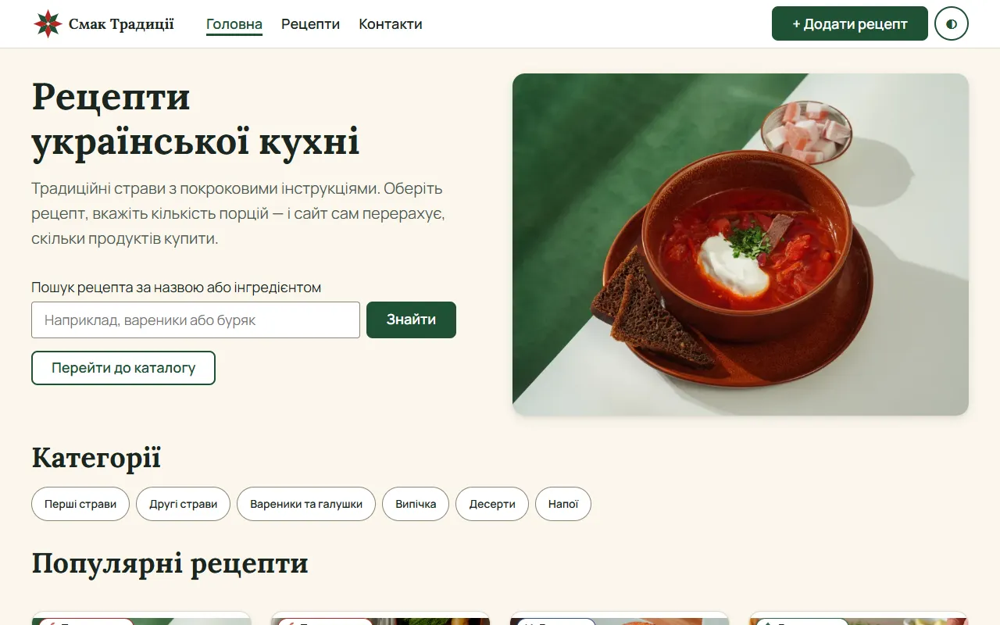
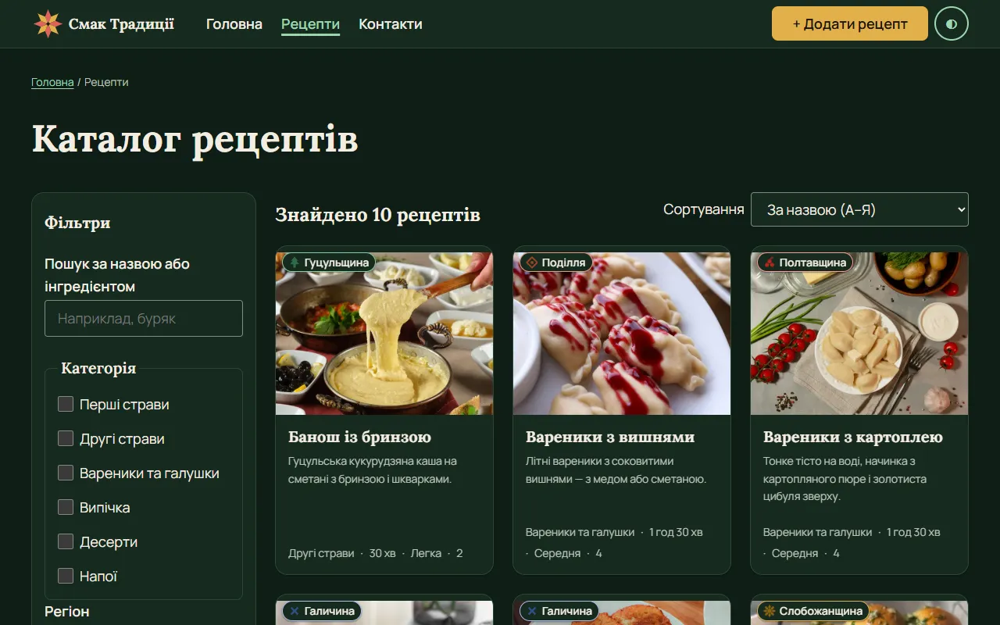
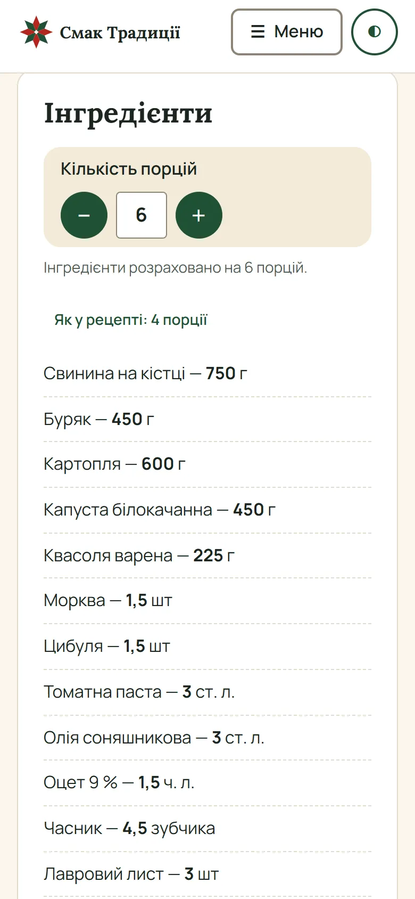
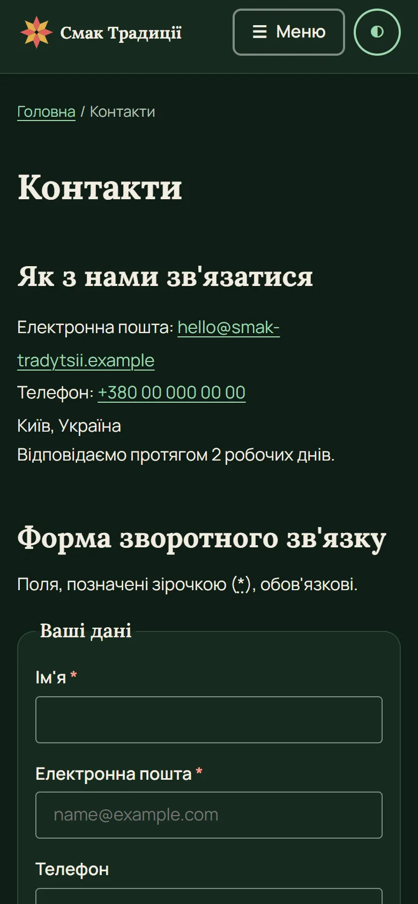

# Смак Традиції — рецепти української кухні

[](https://github.com/bodyasnx/semchuk-web-practice/actions/workflows/ci.yml)
[](https://smak-tradytsii.netlify.app)


Сайт з рецептами української кухні: каталог із пошуком і фільтрами, покрокові інструкції
та **калькулятор, що перераховує інгредієнти на потрібну кількість порцій**. Сайт можна встановити
як застосунок (PWA). Проєкт виконано в межах навчальної практики «WEB-технології та WEB-дизайн»
(10 практичних робіт, див. [CHANGELOG.md](CHANGELOG.md)).

**🌐 Живий сайт: https://smak-tradytsii.netlify.app**
API: https://smak-tradytsii-api.onrender.com/api/recipes

> API працює на безкоштовному Render: після 15 хв без запитів сервер «засинає», і перше
> завантаження може тривати до хвилини. Додані рецепти зникають після перезапуску сервера —
> подробиці в [docs/DEPLOY.md](docs/DEPLOY.md#4-обмеження-безкоштовного-render--чесно).

## Скриншоти

| Головна (desktop) | Каталог, темна тема |
|---|---|
|  |  |

| Перерахунок порцій (mobile) | Контакти, темна тема (mobile) |
|---|---|
|  |  |

## Функції

- **Каталог:** пошук за назвою чи інгредієнтом (debounce 300 мс), фільтри за категорією, регіоном
  і часом, сортування; стан фільтрів зберігається в URL.
- **Сторінка рецепта:** фото, характеристики, інгредієнти, кроки; розмітка Schema.org `Recipe`.
- **Калькулятор порцій (1–20):** перерахунок з округленням за одиницею виміру — грами до цілих
  (понад 100 г — до 5), штуки до половини, «за смаком» не змінюється ([алгоритм](docs/TZ.md#8-алгоритм-перерахунку-порцій)).
- **Додавання, редагування й видалення рецептів** з валідацією на клієнті й сервері.
- **Форма зворотного зв'язку** (телефон у форматі `+380XXXXXXXXX`).
- **Світла і темна тема** (за системою або вручну, вибір запам'ятовується).
- **PWA:** встановлення на телефон чи комп'ютер, офлайн-сторінка, кешування фото й статики.
- **Доступність і швидкодія:** Lighthouse (mobile) 97–100 у всіх категоріях на живому сайті,
  0 порушень axe, робота з клавіатури.

## Стек

| Частина | Технології |
|---|---|
| Клієнт | React 18, Vite 8, React Router 7, CSS custom properties (дизайн-токени) |
| Сервер | Node.js 22, Express 5, cors, dotenv, morgan; дані в JSON-файлах (`fs/promises`) |
| PWA | Web App Manifest, власний service worker |
| Тести | Vitest, React Testing Library, `node:test`; Lighthouse, axe, Postman |
| CI/CD | GitHub Actions (тести і збірка), Netlify (клієнт), Render (API) |
| Ранні ПР | HTML5, CSS3, ванільний JavaScript (`client/static/`), Tailwind CSS для порівняння |

## Запуск локально

Потрібен **Node.js 20.19 або новіший** (`node -v`).

```bash
git clone https://github.com/bodyasnx/semchuk-web-practice.git
cd semchuk-web-practice
npm run setup   # залежності в корені, у server/ і в client/app/
npm run dev     # API і сайт разом
```

| Частина | Адреса |
|---|---|
| API | http://localhost:3001/api/recipes |
| Сайт | http://localhost:5173 |

`concurrently` запускає обидві частини в одному терміналі (рядки журналу позначено `[api]` і `[web]`),
зупинити — `Ctrl+C`. Можна і в двох терміналах: `cd server && npm run dev` та `cd client/app && npm run dev`.

**Налаштування (необов'язково).** Без `.env` усе працює зі значеннями за замовчуванням:

```bash
cp server/.env.example server/.env           # PORT, CLIENT_ORIGIN
cp client/app/.env.example client/app/.env   # VITE_API_URL, VITE_SITE_URL
```

| Команда | Що робить |
|---|---|
| `npm run dev` | API і сайт з автоперезапуском |
| `npm test` | автотести API (`node:test`) і клієнта (Vitest) |
| `npm run build` | production-збірка клієнта в `client/app/dist/` (з service worker) |
| `npm run preview --prefix client/app` | перегляд production-збірки на http://localhost:4173 |
| `npm run start:api` | запуск API без автоперезапуску |
| `npm run seo --prefix client/app` | оновити `sitemap.xml` і `robots.txt` |

## Тести

`npm test` запускає 8 тестів API (CRUD рецептів, валідація, CORS) і 25 тестів клієнта
(перерахунок порцій, валідація, компоненти). Ті самі тести й збірку запускає
[GitHub Actions](.github/workflows/ci.yml) на кожен push і Pull Request. Ручний чек-лист на 15 кейсів
і результати — в [docs/TESTING.md](docs/TESTING.md), Lighthouse і axe — в [docs/AUDIT.md](docs/AUDIT.md).

## Структура

```
client/app/          React-застосунок (ПР 7–10)
  public/            фото (WebP), шрифти, SVG, іконки PWA, manifest, offline.html
  src/               сторінки, компоненти, хуки, утиліти, sw.js (service worker)
  netlify.toml       збірка, rewrite для React Router, заголовки кешування
client/static/       статична версія на HTML/CSS/JS (ПР 4–6)
server/              REST API на Express (ПР 8)
  src/               маршрути, middleware, валідація, сховище
  data/recipes.json  10 рецептів
docs/                документація (нижче)
render.yaml          опис API для Render
.github/workflows/   CI
```

## Документація

| Файл | Зміст |
|---|---|
| [TZ.md](docs/TZ.md) | технічне завдання |
| [UX.md](docs/UX.md), [wireframes/](docs/wireframes/) | персони, user stories, user flow, wireframe |
| [DESIGN.md](docs/DESIGN.md), [design-system.html](docs/design-system.html) | палітра, контрасти, дизайн-система |
| [HTML.md](docs/HTML.md), [STYLES.md](docs/STYLES.md), [JS.md](docs/JS.md) | розмітка, стилі, JavaScript (ПР 4–6) |
| [REACT.md](docs/REACT.md) | дерево компонентів і потоки даних |
| [API.md](docs/API.md), [postman/](docs/postman/) | ендпоінти, формат помилок, колекція Postman |
| [TESTING.md](docs/TESTING.md), [AUDIT.md](docs/AUDIT.md) | тестування; Lighthouse, SEO, доступність |
| [DEPLOY.md](docs/DEPLOY.md) | деплой на Netlify і Render, PWA, обмеження |
| [CREDITS.md](docs/CREDITS.md) | джерела фото і шрифтів |
| [AI.md](docs/AI.md) | журнал використання AI |
| [CHANGELOG.md](CHANGELOG.md) | історія версій pr-01 … v1.0.0 |

## Автор і ліцензія

Семчук Богдан, навчальна практика 2026. Код — за ліцензією [MIT](LICENSE).
Фото страв — Unsplash і Pexels (їхні ліцензії, див. [CREDITS.md](docs/CREDITS.md)), шрифти Lora і Manrope — SIL OFL.
