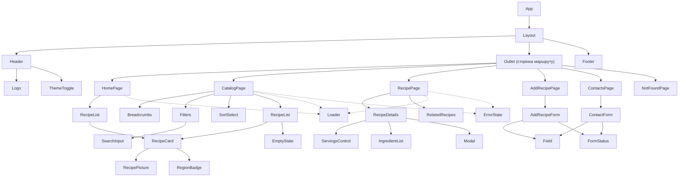

# React-версія сайту

**Практична робота:** ПР 7 «Перенесення на React»
**Код:** [client/app/](../client/app/) — React 18, Vite, React Router 7, JavaScript.
Статична версія ([client/static/](../client/static/)) лишається без змін — вона є частиною звіту ПР 4–6.

## 1. Як запустити

Потрібен Node.js 20.19+ (перевірено на Node 26).

```bash
cd client/app
npm install       # один раз: встановити залежності в node_modules/
npm run dev       # сервер розробки з миттєвим оновленням: http://localhost:5173
npm run build     # production-збірка в client/app/dist/
npm run preview   # переглянути зібрану версію: http://localhost:4173
```

`node_modules/` і `dist/` у git не потрапляють (див. `.gitignore`).

## 2. Маршрути

| Адреса | Сторінка | Статичний аналог |
|---|---|---|
| `/` | `HomePage` | `index.html` |
| `/recipes` | `CatalogPage` (фільтри в URL: `?q=…&category=…&region=…&time=…&sort=…`) | `recipes.html` |
| `/recipes/:id` | `RecipePage` | `recipe.html?id=…` |
| `/recipes/new` | `AddRecipePage` | `add-recipe.html` |
| `/contacts` | `ContactsPage` | `contacts.html` |
| `*` | `NotFoundPage` | `404.html` |

Усі маршрути вкладені в `Layout` (шапка, футер, `<Outlet />`). `/recipes/new` оголошено окремим
маршрутом — статичний сегмент має пріоритет над `:id`, тож «new» не сприймається як id рецепта.

## 3. Дерево компонентів



Пунктир — компоненти станів, які показуються замість вмісту під час завантаження або після помилки.

**Компоненти (25):** `Layout`, `Header`, `Footer`, `Logo`, `Breadcrumbs`, `ThemeToggle`, `Loader`,
`ErrorState`, `EmptyState`, `Modal`, `RecipeCard`, `RecipeList`, `RecipePicture`, `RegionBadge`,
`RecipeDetails`, `RelatedRecipes`, `ServingsControl`, `IngredientList`, `Filters`, `SearchInput`,
`SortSelect`, `AddRecipeForm`, `ContactForm`, `Field` (+ `Checkbox`, `FieldError`), `FormStatus`.

## 4. Які дані де живуть

Правило: кожні дані мають **одне джерело правди**, а все, що з них можна обчислити, обчислюється
під час рендеру, а не копіюється в окремий стан.

| Дані | Де живуть | Хто змінює | Чому саме там |
|---|---|---|---|
| Список рецептів | `useFetch(RECIPES_URL)` у кожній сторінці, що його показує | хук (запит, `refetch`) | Сторінки незалежні; у ПР 8 URL зміниться на REST API, а компоненти — ні |
| Фільтри каталогу (`q`, категорії, регіон, час, сортування) | **адреса сторінки** (`useSearchParams`) | `CatalogPage` через `setSearchParams(…, { replace: true })` | Посиланням на відфільтрований каталог можна поділитися; кнопка з головної `/recipes?category=drinks` працює без додаткового коду |
| Знайдені рецепти, лічильник «Знайдено N» | обчислюються в `CatalogPage` (`useMemo`) | — | Похідні від рецептів і фільтрів |
| Текст у полі пошуку до debounce | `SearchInput` (`useState`) + `useDebounce` 300 мс | людина, що друкує | Список не перемальовується на кожну літеру |
| Розгорнута панель фільтрів / меню | `Filters` / `Header` (`useState`) | клік, Esc, перехід | Стан інтерфейсу, потрібний лише одному компоненту |
| Тема | `ThemeToggle` → `useLocalStorage('smak:theme')` + атрибут `data-theme` на `<html>` | кнопка теми | Пам'ятається між візитами; скрипт у `index.html` ставить тему ще до запуску React |
| Кількість порцій | `RecipeDetails` → `useLocalStorage('smak:servings:<id>')` | `ServingsControl` через `onChange` | Окремо для кожного рецепта; перераховані інгредієнти — похідні (`IngredientList`, `useMemo`) |
| Текст, який людина друкує в полі порцій | `ServingsControl` (`draft`) | введення | Поле може тимчасово містити «» чи «0», поки людина не завершила введення |
| Відкрите вікно підтвердження | `RecipeDetails` (`confirmOpen`) → проп `open` у `Modal` | кнопки «Видалити» / «Скасувати», Esc | `Modal` лише синхронізує стан із `<dialog>` (`showModal()` / `close()`) |
| Значення форм, «торкнуті» поля, статус | `useForm` у `AddRecipeForm` / `ContactForm` | поля через `setField`, `touch` | Керовані поля; помилки — похідні від значень (`validateRecipe`, `validateContact`) |
| Рядки інгредієнтів і кроків | масиви в `values` форми, кожен рядок має свій `key` | «+ Додати», «Видалити» | `key` прив'язує текст, помилки і фокус до рядка, а не до його номера |

**Потік даних:** дані йдуть згори вниз через props (`CatalogPage` → `Filters` → `SearchInput`),
а зміни — знизу вгору через функції-колбеки (`onChange`, `onSearch`, `onReset`). Компоненти
`Filters`, `ServingsControl`, `Modal` — «керовані»: самі не вирішують, яке значення показати.

## 5. Власні хуки

| Хук | Повертає | Ключова ідея |
|---|---|---|
| `useFetch(url)` | `{ data, loading, error, refetch }` | `useEffect` із залежностями `[url, attempt]`; `AbortController` у функції прибирання скасовує застарілий запит; мережеву помилку перекладено українською |
| `useLocalStorage(key, initial)` | `[value, setValue]` як у `useState` | Початкове значення читається один раз (лінива ініціалізація), запис — в ефекті; у приватному режимі не падає |
| `useDebounce(value, delay)` | значення із затримкою | Кожна нова літера скасовує попередній таймер через функцію прибирання |
| `useForm({ createInitialValues, validate, onSubmit })` | значення, `errorFor`, `setField`, `touch`, `handleSubmit`, статус | Помилка поля видима після виходу з нього або після спроби надіслати; фокус на першому помилковому полі |
| `useDocumentTitle(title, description)` | — | `document.title` і meta description для кожного маршруту |

## 6. Що перенесено зі статичної версії

- **Стилі** — `reset.css`, `tokens.css`, `typography.css`, `components.css`, `site.css` скопійовано
  без змін; змінено лише шлях до орнаменту в `site.css` (`/assets/…`). Додано один `app.css`:
  `#root { display: contents }`, щоб обгортка React не ламала flex-розкладку `body`.
  Вигляд звірено знімками на 360 і 1280 px для всіх сторінок.
- **Логіка** — `servings.js` скопійовано **без змін** (`diff` порожній) у `src/utils/`; `labels.js` і
  `storage.js` — так само. Фільтрація каталогу — `utils/catalog.js`, валідація форм — `utils/validation.js`:
  чисті функції без React, їх покриємо тестами в ПР 9.
- **Дані й медіа** — `recipes.json`, фото страв і SVG скопійовано в `public/`.

## 7. Перевірка

- `npm run build` — без помилок і попереджень.
- Автоматизовані тести в Chrome (puppeteer-core) — production-збірка і dev-режим (StrictMode), консоль без помилок:
  - на всіх 7 маршрутах (зокрема невідомий рецепт і невідома адреса) — рівно один `h1` і свій `title`;
  - пошук за інгредієнтом із debounce, фільтри й сортування в URL, «нічого не знайдено», скидання;
  - порції 4 → 10 (1 250 г, 7,5 зубчика, 6,3 л), 25 → 20 і 0 → 1 з повідомленнями, межі,
    збереження після перезавантаження, «Як у рецепті»;
  - модальне вікно: фокус на «Скасувати», фокус-пастка, Esc, повернення фокусу;
  - тема зберігається і застосовується до запуску React; бургер: `aria-expanded`, Esc, закриття при переході;
  - стан помилки (обірваний запит) і «Спробувати ще»;
  - форми: порожнє надсилання (кількість помилок, фокус на першому полі, `aria-describedby`),
    «лише пробіли», email, телефон `+380XXXXXXXXX`, довжина повідомлення, видалення рядка 2 зі
    збереженням тексту рядка 3, фокус після додавання/видалення, успішне надсилання і скидання форми.

## 8. Чим React-версія краща за статичну

| | Статична версія (ПР 6) | React-версія (ПР 7) |
|---|---|---|
| Шапка і футер | Скопійовані в 6 HTML-файлів | Один `Layout` |
| Оновлення інтерфейсу | Вручну: `innerHTML`, пошук елементів, синхронізація форми з URL | Описуємо, *як має виглядати* інтерфейс для стану, React оновлює DOM сам |
| Перехід між сторінками | Повне перезавантаження | Без перезавантаження (SPA), тема й дані не «блимають» |
| XSS | Потрібне ручне `escapeHtml` у шаблонах | JSX екранує текст автоматично |
| Повторне використання | Функції-шаблони рядків | Компоненти з props, власні хуки |
