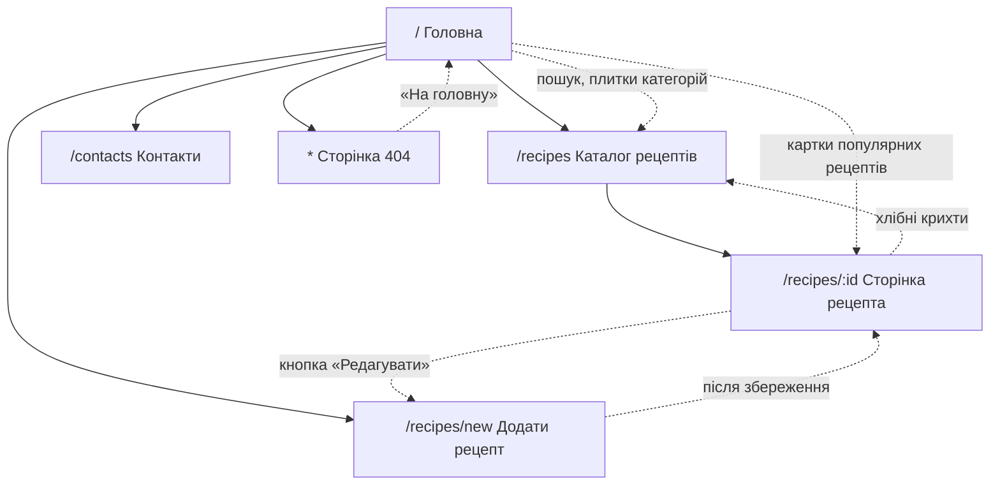

# UX-аналіз

**Проєкт:** «Смак Традиції» — рецепти української кухні
**Практична робота:** ПР 2 «UX-аналіз і wireframe»
**Головна функція:** перерахунок інгредієнтів на кількість порцій (Ф6 з [TZ.md](TZ.md))

---

## 1. Персони

| | Персона 1 — «Новачок» | Персона 2 — «Господиня свята» |
|---|---|---|
| **Ім'я** | Оля Коваленко | Галина Петрівна Мельник |
| **Вік** | 21 рік | 48 років |
| **Заняття** | Студентка 3 курсу, вперше живе окремо від батьків у гуртожитку | Бухгалтерка, мама двох дорослих дітей, щороку приймає родину на Різдво і Великдень |
| **Цілі** | Навчитися готувати 5–6 простих домашніх страв «як у мами»; готувати на 1–2 порції, щоб нічого не викидати | Швидко знайти перевірений рецепт і приготувати його на 10–12 гостей; зберегти власні сімейні рецепти |
| **«Болі»** | Рецепти розраховані на 6–8 порцій, а ділити «3 яйця на 4» вона не вміє; незрозумілі кроки («до готовності»); сайти з рекламою, де рецепт треба шукати під статтею | Перераховує інгредієнти вручну на калькуляторі й помиляється; дрібний шрифт і перевантажені сторінки; бабусині рецепти записані на папірцях і губляться |
| **Пристрій** | Смартфон Android (екран 360–390 px), відкриває рецепт просто на кухні | Ноутбук 15" удома для пошуку, планшет на кухні під час готування |
| **Цитата** | «Мені треба борщ на двох, а не на каструлю для гуртожитку». | «Хочу ввести "12 порцій" і просто піти в магазин зі списком». |
| **Що їй дає сайт** | Калькулятор порцій від 1, покрокові інструкції, чистий мобільний інтерфейс | Перерахунок на 10–20 порцій, фільтр за регіоном, форма «Додати рецепт» |

## 2. User stories

| № | User story | Пріоритет | Вимога з ТЗ |
|---|---|---|---|
| US1 | Як **студентка-новачок**, я хочу **змінити кількість порцій у рецепті з 4 на 2**, щоб **приготувати рівно стільки, скільки з'їм, і не викидати їжу**. | Must | Ф6 |
| US2 | Як **господиня, що приймає гостей**, я хочу **побачити інгредієнти вже перераховані на 12 порцій з округленими значеннями**, щоб **скласти список покупок без калькулятора**. | Must | Ф6 |
| US3 | Як **користувач, що шукає страву**, я хочу **знайти рецепт за назвою або інгредієнтом (наприклад, «буряк»)**, щоб **не гортати весь каталог**. | Must | Ф2 |
| US4 | Як **користувачка, що цікавиться традиціями**, я хочу **відфільтрувати рецепти за регіоном (наприклад, Гуцульщина) і категорією**, щоб **готувати страви саме цього краю**. | Should | Ф3 |
| US5 | Як **господиня з сімейними рецептами**, я хочу **додати власний рецепт через форму з підказками про помилки**, щоб **зберегти його і поділитися з родиною**. | Should | Ф7, Ф9 |

## 3. User flow головного сценарію

Сценарій: користувач заходить на сайт, знаходить рецепт і перераховує інгредієнти
на потрібну кількість порцій.

## 4. Карта сайту

Суцільні стрілки — ієрархія сторінок, пунктирні — переходи за посиланнями.
Шапка (меню) і футер є на всіх сторінках, тому з будь-якої сторінки можна перейти
на Головну, Каталог, «Додати рецепт» і Контакти.

## 5. Wireframe

Low-fi wireframe 4 ключових екранів зроблено у вигляді HTML/CSS-сторінок
(Figma не використовується — погоджено з викладачем). Точка входу —
[wireframes/prototype.html](wireframes/prototype.html).

## 6. Юзабіліті-оцінка

### 6.1. Чому замість коридорного тестування

Планувалося коридорне тестування прототипу з 2 одногрупниками. Провести його не вдалося:
залучити учасників не було змоги. Тому прототип оцінено самостійно двома експертними
методами, які не потребують учасників:

- **Евристична оцінка** — перевірка кожного екрана за 10 евристиками юзабіліті
  Якоба Нільсена; кожній знайденій проблемі присвоюється серйозність від 0 до 4.
- **Когнітивний прохід (cognitive walkthrough)** — покрокове проходження 4 типових
  сценаріїв від імені персон із розділу 1 з відповіддю на питання: чи зрозуміє
  користувач, що робити далі, чи помітить потрібний елемент і чи побачить результат дії.

**Обмеження.** Оцінку проводив автор прототипу, тому вона не замінює тестування
з реальними користувачами: автор знає, де що розташовано, і може не помітити проблем,
очевидних для нової людини. Тестування з користувачами варто провести на етапі
готової верстки (ПР 4–6).

**Шкала серйозності (за Нільсеном):**
0 — не проблема; 1 — косметична, виправити за наявності часу; 2 — незначна, низький
пріоритет; 3 — серйозна, важливо виправити; 4 — катастрофа, виправити обов'язково.

### 6.2. Когнітивний прохід

| № | Сценарій | Версія | Час | Результат | Нотатки |
|---|---|---|---|---|---|
| С1 | Знайти рецепт борщу і відкрити його | mobile | 6 с | ✅ | Знайшов рецепт борщу без проблем. |
| С2 | Знайти борщ і з'ясувати, скільки буряка потрібно на 10 порцій | desktop | 7 с | ✅ | Проблем не було, на 10 порцій видно 750 г буряка. |
| С3 | Знайти всі другі страви з Гуцульщини | mobile | 16 с | ✅ | Вагань не було. |
| С4 | Додати рецепт «Вареники з сиром» (2 інгредієнти, 1 крок), спершу без категорії | desktop | 1 хв 40 с | ⚠️ | Спочатку не міг знайти «Додати рецепт» — помітив його у верхній частині екрана, але воно виглядає як звичайний текст, тому його важко побачити. Також вагався з полями вибору категорії, кроків і кількості інгредієнтів, бо форма поки виглядає незрозумілою. Зрештою рецепт було збережено. |

### 6.3. Евристична оцінка

| Евристика | Висновок |
|---|---|
| H1 Видимість стану системи | Без проблем: зрозуміло, на якій я сторінці; інгредієнти змінюються після зміни порцій, і це добре видно. |
| H2 Відповідність реальному світу | Без проблем: слова й одиниці зрозумілі одразу; порядок «інгредієнти → кроки» логічний. |
| H3 Контроль і свобода користувача | Без проблем: усе легко скинути й повернути. |
| H4 Послідовність і стандарти | Без проблем: кнопки й картки однакові на всіх екранах. |
| H5 Запобігання помилкам | 0 автоматично змінюється на 1, 25 — на 20, букви в поле не вводяться. Під інгредієнтами є примітка (порції від 1 до 20, округлення залежить від одиниці, «за смаком» не перераховується). У формі нового рецепта зверху написано, що всі поля обов'язкові. Єдине: число виправляється «мовчки», без повідомлення в момент виправлення. |
| H6 Впізнавання замість запам'ятовування | Без проблем: на картках (наприклад, «Популярні рецепти» на головній) одразу видно складність і час. |
| H7 Гнучкість і ефективність | Без проблем: до рецепта можна швидко дійти; число порцій можна ввести вручну, після Enter усе перераховується. |
| H8 Естетичний і мінімалістичний дизайн | Без проблем: нічого не відволікає, картку з інгредієнтами видно чітко. |
| H9 Допомога в розпізнаванні та виправленні помилок | Без проблем: тексти помилок зрозумілі, курсор переходить до поля з помилкою. |
| H10 Довідка і документація | Без проблем: калькулятор порцій зрозумілий без пояснень. |

**Знайдені проблеми:**

| № | Евристика | Проблема | Серйозність (0–4) | Виправлення |
|---|---|---|---|---|
| П1 | H4, H8 (сценарій С4) | Посилання «Додати рецепт» у шапці виглядає як звичайний текст, і його важко помітити. Частково вирішиться під час стилізації, але вже у wireframe важлива дія має бути кнопкою. | 2 | Виправлено у wireframe (див. 6.4) |
| П2 | H10 (сценарій С4) | Форма додавання рецепта незрозуміла (категорія, кроки, кількість інгредієнтів). | 2 | Виправлено у wireframe (див. 6.4) |
| П3 | H5 | Число порцій виправляється без повідомлення. | 1 | У wireframe не виправляємо: коротке повідомлення додамо в ПР 6 разом із JS-валідацією |

### 6.4. Виправлення wireframe

Виправлено проблеми із серйозністю ≥ 2.

**П1 — «Додати рецепт» стало кнопкою** (усі 8 екранів):
- desktop: пункт прибрано з текстового меню, у правій частині шапки з'явилася помітна
  темна кнопка «+ Додати рецепт» поруч із перемикачем теми; на сторінці форми вона
  позначена як поточна (`aria-current="page"`, додаткова рамка);
- mobile: у бургер-меню «+ Додати рецепт» — окрема темна кнопка під пунктами меню,
  щоб дія виглядала однаково на обох версіях (H4).

**П2 — зрозуміліша форма** (`desktop/add-recipe.html`, `mobile/add-recipe.html`):
- розділи форми пронумеровано за порядком заповнення: «1. Основне про страву»,
  «2. Інгредієнти», «3. Кроки приготування»;
- під полем «Категорія» — підказка «Розділ каталогу, у якому з'явиться рецепт»;
- у розділі «Інгредієнти» — пояснення, що кількість вказується на базову кількість порцій
  (сайт сам перерахує її), а для солі й спецій треба обрати «за смаком» і залишити
  кількість порожньою; підказка прив'язана до поля «Кількість» через `aria-describedby`;
- у розділі «Кроки приготування» — підказка «Один крок — одна дія, у порядку виконання»
  і як додати наступний крок.

**Помилка верстки, видна на скриншоті під час оцінки.** На desktop-версії форми «Додати рецепт»
усі поля були стиснуті в одну вузьку колонку. Причина — помилка в CSS сітки: клас
`.c-8` задавав `grid-column: span 8`, а `.start-3` перезаписував початок колонки, і ширина
скидалася до 1 колонки. Класи `.c-N` переписано на `grid-column-end: span N`, тепер форма
займає 8 колонок із 3-ї по 10-ту, як і планувалося.

**Не виправлено (заплановано):** П3 — повідомлення при автоматичному виправленні числа
порцій, ПР 6.
