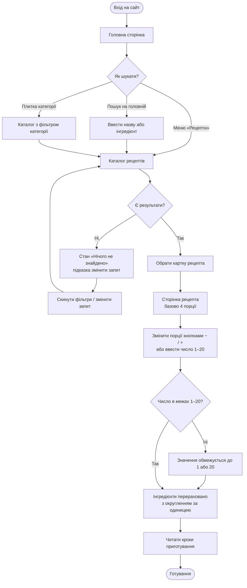
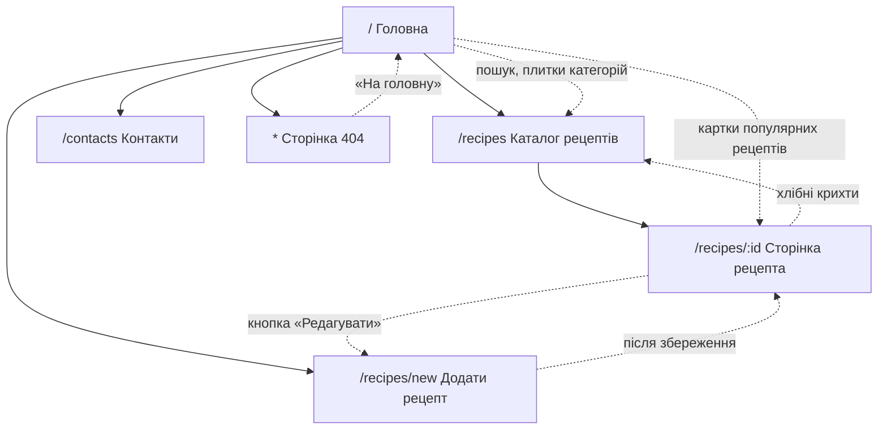

# UX-аналіз

**Проєкт:** «Смак Традиції» — рецепти української кухні
**Практична робота:** ПР 2 «UX-аналіз і wireframe»
**Головна функція:** перерахунок інгредієнтів на кількість порцій (Ф6 з [TZ.md](TZ.md))

---

## 1. Персони

| | Персона 1 — «Новачок» | Персона 2 — «Господиня свята» |
|---|---|---|
| **Ім'я** | Оля Коваленко | Галина Петрівна Мельник |
| **Вік** | 21 рік | 48 років |
| **Заняття** | Студентка 3 курсу, вперше живе окремо від батьків у гуртожитку | Бухгалтерка, мама двох дорослих дітей, щороку приймає родину на Різдво і Великдень |
| **Цілі** | Навчитися готувати 5–6 простих домашніх страв «як у мами»; готувати на 1–2 порції, щоб нічого не викидати | Швидко знайти перевірений рецепт і приготувати його на 10–12 гостей; зберегти власні сімейні рецепти |
| **«Болі»** | Рецепти розраховані на 6–8 порцій, а ділити «3 яйця на 4» вона не вміє; незрозумілі кроки («до готовності»); сайти з рекламою, де рецепт треба шукати під статтею | Перераховує інгредієнти вручну на калькуляторі й помиляється; дрібний шрифт і перевантажені сторінки; бабусині рецепти записані на папірцях і губляться |
| **Пристрій** | Смартфон Android (екран 360–390 px), відкриває рецепт просто на кухні | Ноутбук 15" удома для пошуку, планшет на кухні під час готування |
| **Цитата** | «Мені треба борщ на двох, а не на каструлю для гуртожитку». | «Хочу ввести "12 порцій" і просто піти в магазин зі списком». |
| **Що їй дає сайт** | Калькулятор порцій від 1, покрокові інструкції, чистий мобільний інтерфейс | Перерахунок на 10–20 порцій, фільтр за регіоном, форма «Додати рецепт» |

## 2. User stories

| № | User story | Пріоритет | Вимога з ТЗ |
|---|---|---|---|
| US1 | Як **студентка-новачок**, я хочу **змінити кількість порцій у рецепті з 4 на 2**, щоб **приготувати рівно стільки, скільки з'їм, і не викидати їжу**. | Must | Ф6 |
| US2 | Як **господиня, що приймає гостей**, я хочу **побачити інгредієнти вже перераховані на 12 порцій з округленими значеннями**, щоб **скласти список покупок без калькулятора**. | Must | Ф6 |
| US3 | Як **користувач, що шукає страву**, я хочу **знайти рецепт за назвою або інгредієнтом (наприклад, «буряк»)**, щоб **не гортати весь каталог**. | Must | Ф2 |
| US4 | Як **користувачка, що цікавиться традиціями**, я хочу **відфільтрувати рецепти за регіоном (наприклад, Гуцульщина) і категорією**, щоб **готувати страви саме цього краю**. | Should | Ф3 |
| US5 | Як **господиня з сімейними рецептами**, я хочу **додати власний рецепт через форму з підказками про помилки**, щоб **зберегти його і поділитися з родиною**. | Should | Ф7, Ф9 |

## 3. User flow головного сценарію

Сценарій: користувач заходить на сайт, знаходить рецепт і перераховує інгредієнти
на потрібну кількість порцій.

## 4. Карта сайту

Суцільні стрілки — ієрархія сторінок, пунктирні — переходи за посиланнями.
Шапка (меню) і футер є на всіх сторінках, тому з будь-якої сторінки можна перейти
на Головну, Каталог, «Додати рецепт» і Контакти.

## 5. Wireframe

Low-fi wireframe 4 ключових екранів зроблено у вигляді HTML/CSS-сторінок
(Figma не використовується — погоджено з викладачем). Точка входу —
[wireframes/prototype.html](wireframes/prototype.html).

## 6. Коридорне тестування

Результати буде додано після тестування з 2 одногрупниками.
